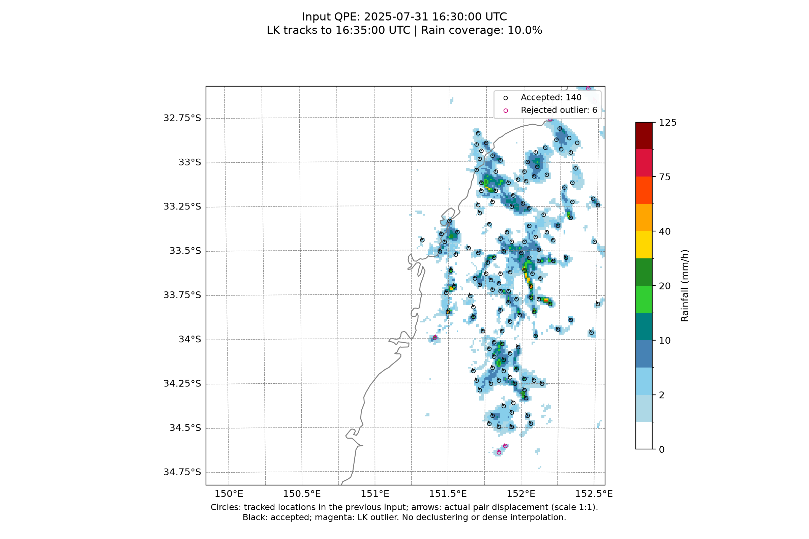
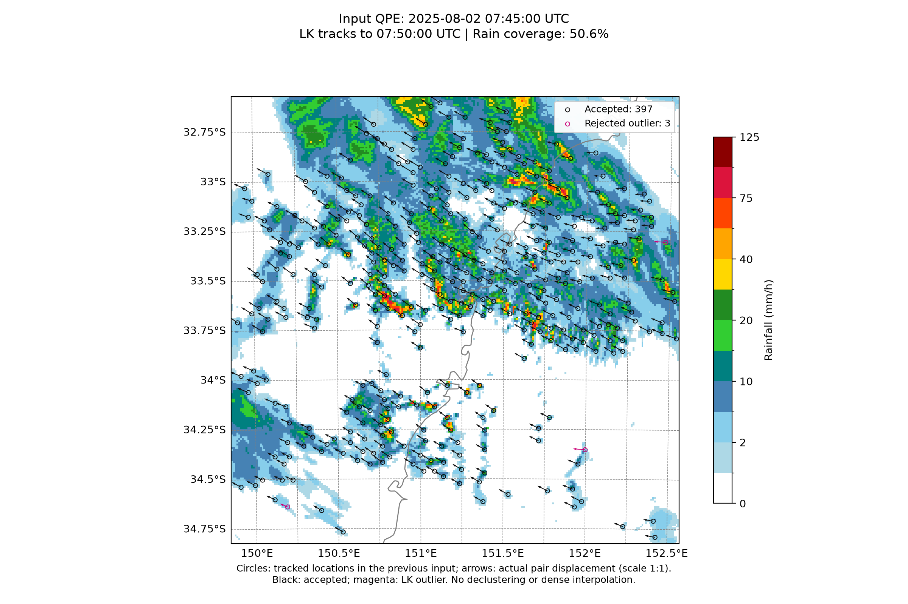

# Event-based sparse LK extraction

The implementation follows the accepted
[extraction plan](event_lk_extraction_plan.md). It reads the frozen 2025 storm
population from `BOM` and writes research results into `BOM_advection`.
Operational rainfall and storm records are read-only inputs.

The adopted research limit is **1,000 detected features per input pair**.
The runner explicitly overrides `fd_kwargs.max_corners` while retaining every
other resolved core setting. The core operational default is unchanged.
The CLI exposes `--max-corners` (default 1000); its resolved value is part of
the immutable run manifest. The initial 400-feature pilots are preserved and
must not be combined with the revised configuration as one population.

## Environment and commands

Use the `bom_cases` environment and editable core checkout. The core now
provides `pysteps_param.advection.sparse` as the public sparse LK interface;
the underlying tracker and fixed settings are unchanged. This core addition
must accompany the Bureau runner when moving to another machine.

```bash
conda activate bom_cases
python -m pip install --no-deps --no-build-isolation -e .

# Read-only full-population inventory; no database or report writes.
bom-extract-event-lk --dry-run

# Extract all 107 storms, or resume this exact run after an interruption.
bom-extract-event-lk --run-id syd_2025_fixed_lk_v1
```

The wrapper `python scripts/extract_event_lk.py` accepts the same arguments.
Source/research database names can be set with `--source-db` and
`--research-db`; the runner requires local MongoDB and distinct source and
research databases. The radar account needs read access to `BOM` and read/write
access to `BOM_advection`.

The default generation is `2417c6c4be66438caac46c416efe770a`; pass
`--generation` explicitly when using another reviewed population. To process
a subset, repeat `--storm-id` using identifiers from the inventory. Preserve
the same selection when resuming. A changed selection, source snapshot,
configuration, dependency version or recorded source-code hash requires a
new run ID; a completed run cannot be overwritten.

The full command above was subsequently run by the user. Its completed
107-storm population has passed [read-back acceptance](2025_lk_and_field_parameters.md).

## Records, arrays and outcomes

Research collections are `runs`, `events`, `pairs` and the `sparse_oflow`
GridFS bucket. Pair records link both source identities and the source storm
to the run's frozen manifest. They include actual source times, nominal and
actual intervals, zero-input indicators, valid fractions, counts and tracked/
accepted velocity summaries. Per-event and run summaries account for every
planned pair. No feature, no successful track, all rejected, unavailable input,
invalid timing and processing failure are separate outcomes. Empty motion
populations have null summary values, never a fabricated zero velocity.

Each available pair has a compressed NPZ payload, including empty arrays
where tracking yields none:

| Array | Meaning |
| --- | --- |
| `detected_xy` | Detected feature locations, image columns/rows in pixels |
| `xy`, `uv` | Tracked locations and displacement in pixels per input pair |
| `outlier_mask` | Existing LK outlier decisions, before declustering |
| `projected_xy_m` | Tracked locations in the analysis projection, metres |
| `velocity_m_s` | Projected x/y components, using actual source interval |
| `endpoint_valid` | Both rounded endpoints fall on observed pixels |
| `base_patch_valid` | Observed 31 × 31 squares around both rounded endpoints |

Bureau grid rows increase in projected y, verified against a decoded stored
field. Projected velocity components are not rotated geographic east/north
components. The validity flags are additional annotations and do not alter
the fixed LK outlier mask. OpenCV fills masked pixels with the image minimum
internally; the base-patch flag does **not** certify the full multilevel
tracking footprint or establish tracking accuracy.

Dense grids, hybrid classification, non-Lagrangian parameter estimation and
event descriptor/tercile selection are subsequent stages. This pass preserves
raw sparse evidence for those analyses.

## Restart and reports

Reports default to `~/data/alan/psteps_advect_data/runs/event_lk/<run-id>/`;
override with `--report-root`. They contain the manifest, full selected input
snapshot, per-event progress and final summary. The run hashes the snapshot
and records resolved LK and transform settings, dependency versions, repository
revisions and relevant source-code hashes. Source revisions can include local
edits; source hashes identify the actual implementation.

The two-field cache avoids repeatedly decoding/transformation of a predecessor.
One writer is permitted per research database/run ID. Payloads are uploaded
before the pair record is published. Resume verifies the bytes and array
inventory of referenced payloads, reuses successful/terminal scientific results
and retries failed or uncommitted pairs. Final publication checks that the
source inventory has not changed during processing. A completed rerun verifies
references and leaves its scientific record unchanged.

The summary reports unreferenced completed GridFS uploads for the run; no
automatic deletion is performed. It does not audit bucket-wide chunks left by
an interrupted upload before a GridFS file document was created.

## Verification

Run the repository tests with:

```bash
python -m pytest -q
```

Tests cover known translation, physical units and coordinate signs, fixed-core
equivalence, masked/dry/unavailable inputs, event-start predecessors, source
mutation, stage outcomes, upload/publication order, payload corruption,
retryable failures and run-identity conflicts. Live database pilot verification
also exercises interruption/resume and completed-run immutability.

### Verified pilot: 22 November 2026

The final `pilot_v2` run used four deterministically selected events: the
minimum-duration event, a winter event near 12 hours, the maximum-duration
event, and the shortest event containing off-grid observations. Selection
used duration, season and input timing, independently of tracking results.

- Planned pairs: 1,244; vector results: 1,243; unavailable predecessor: 1.
- Tracked vectors: 243,790; accepted: 239,266; outlier-rejected: 4,524.
- Two off-grid pairs had actual intervals of 240 and 360 seconds.
- All payload checksums, vector counts, projected coordinates and physical
  velocity conversions passed a full pilot payload read-back audit.
- A deliberate interruption after five published pairs resumed without
  replacing those payloads. Reopening the complete run preserved its record.
- No unreferenced completed uploads were found.
- Compressed array payloads totalled 8,838,865 bytes. Processing the resumed
  run took 22.4 seconds. A simple full-population extrapolation is about
  165 MB of arrays and seven minutes of processing; this excludes metadata,
  preflight, snapshots and the five pre-interruption pairs' processing time.

The standalone full-population inventory took about six seconds with a peak
RSS of approximately 905 MiB. Rainfall caching is limited to two fields, but
the selected catalogue and input snapshot are held in memory; total memory
use therefore also depends on the population size and imported libraries.

The full inventory contains 23,134 pairs, with 22 unavailable inputs, 17
off-grid pairs and no invalid-timing pairs. No pair contains a stored explicit
zero field in this particular storm population; synthetic dry/masked tests
exercise those paths.

External evidence:

- [Pilot manifest](../../../data/alan/psteps_advect_data/runs/event_lk/pilot_v2/manifest.json)
  and [summary](../../../data/alan/psteps_advect_data/runs/event_lk/pilot_v2/summary.json).
- [Restart verification](../../../data/alan/psteps_advect_data/runs/event_lk/pilot_verification/pilot_v2_verification.json).
- [Payload audit](../../../data/alan/psteps_advect_data/runs/event_lk/pilot_verification/pilot_v2_payload_audit.json).
- [Inventory resource measurement](../../../data/alan/psteps_advect_data/runs/event_lk/pilot_verification/full_inventory_resources.txt).

Source snapshots accompanying `pilot_v2` match its recorded source hashes.
Earlier `pilot_short_v1` and `pilot_winter_long_v1` runs remain labelled pilot
records; their implementation predates the final explicit array-unit metadata.
Do not combine overlapping pilot runs as independent scientific samples.

### Initial 400-feature rainfall and vector-location figures

These figures retain the initial baseline. See the revised 1,000-feature pilot
below for the adopted configuration.

Two illustrative inputs from the long winter pilot event show contrasting
rain coverage. Both use the viewer's shared rainfall colours and boundaries,
12 × 8 canvas, coastline and geographic grid. Circles mark the tracked
locations on the **previous input**, where features were detected; arrows
show the displacement to the next observation at scale 1:1. Black denotes
accepted tracks and magenta denotes rejected LK outliers. These are raw
tracked locations before declustering or interpolation, not dense grid values.

1. [31 July, 16:30 UTC input](../figs/pilot_lk_20250731T163500Z.png):
   10.0% rain coverage; 140 accepted tracks and 6 rejected outliers.
2. [2 August, 07:45 UTC input](../figs/pilot_lk_20250802T075000Z.png):
   50.6% rain coverage; 397 accepted tracks and 3 rejected outliers.





The examples were selected by previous-input WAR nearest 10% and 60% among
pilot vector pairs; the largest available coverage is 50.6%. They support
subjective inspection, not a representative case-selection or accuracy claim.
Filenames identify the pair's ending nominal slot; titles give the actual
rainfall input time. [Figure metadata](../figs/pilot_lk_figures.json) records
the run, source times, counts and stored vector-payload hash.

Regenerate from the existing pilot results without rerunning tracking:

```bash
python scripts/plot_event_lk_pilot.py --run-id pilot_v2 --output-dir figs
```

The [plotting script](../scripts/plot_event_lk_pilot.py) adapts the earlier
sparse-stage diagnostic and uses the current viewer's custom-CRS projection
builder, so no EPSG authority number is required.
Regenerated files are now prefixed with the run ID; the original figure links
above are retained for the initial pilot.

### Adopted 1,000-feature pilot

`pilot_1000_v1` repeats the same four events with `max_corners=1000` and all
other resolved settings unchanged. The old pilots and figures are preserved.
All 1,244 pairs are accounted for: 1,243 vector results and one unavailable
predecessor. Processing took 22.8 seconds; no unreferenced completed uploads
were found. All 1,243 payloads passed checksum, count, coordinate and velocity
read-back checks. The repository test suite passed 34 tests.

This pilot detected 245,199 features and tracked 245,018 vectors, of which
240,505 were accepted and 4,513 rejected. The maximum detected in any one
pair was 490. Raising the cap permits more vectors; the unchanged feature
quality and spacing rules still determine how many can be found.

Updated inspection figures:

- [Patchy input: 31 July, 16:30 UTC](../figs/pilot_1000_v1_lk_20250731T163500Z.png):
  140 accepted and 6 rejected tracks, unchanged because the old cap was not reached.
- [Widespread input: 2 August, 07:45 UTC](../figs/pilot_1000_v1_lk_20250802T075000Z.png):
  423 accepted and 5 rejected tracks, from 428 detections (previously capped at 400).


The [new figure metadata](../figs/pilot_1000_v1_figures.json),
[run manifest](../../../data/alan/psteps_advect_data/runs/event_lk/pilot_1000_v1/manifest.json)
and [payload audit](../../../data/alan/psteps_advect_data/runs/event_lk/pilot_verification/pilot_1000_v1_payload_audit.json)
identify the revised configuration and results. Regenerate these figures with
`python scripts/plot_event_lk_pilot.py --run-id pilot_1000_v1 --output-dir figs`.
The full production run subsequently completed with the new 1,000-feature
default; see [acceptance](2025_lk_and_field_parameters.md).
Earlier throughput/storage extrapolations belong to the 400-feature
pilot and are approximate planning figures, not measurements of a full run.
